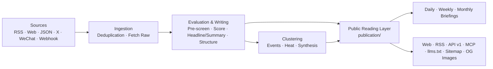

# Architecture



## Three Main Processes

| Process | Location | Responsibilities |
|---|---|---|
| **api** | `apps/api/` | Fastify backend. Internal site APIs (`/api/site/`), Public API (`/api/v1/`), RSS feeds, MCP server, Admin APIs, image proxy, social OG share images. |
| **worker** | `apps/worker/` | `pg-boss` job queues and scheduled tasks: source ingestion, LLM pipelines, clustering, heat calculation, daily reports, alerts, cleanup. |
| **web** | `apps/web/` | React Router SSR web application. Reads data strictly from `api` via HTTP; never touches the database directly. |

Business logic resides in `packages/backend/`. Shared contracts, types, and constants reside in `packages/contracts/`. Site identity, branding, and copy reside in `site/`. Domain taxonomy, seed sources, prompts, and scoring thresholds reside in `industry/`. Site-specific standalone extensions reside in `modules/` (see "Modules" below).

## Core Invariant Rules

- **Unified Public Read Layer**: Web, RSS, API, MCP, sitemaps, and share images all read exclusively from `packages/backend/src/publication/`. Scope, curated slots (machine feeds output only 1 representative article per story), and factual verification requirements are centralized in `publication/scope.ts`.
- **Cache Does Not Extend Stale Content**: Mutable content revalidates according to `Cache-Control`. MCP HTTP endpoints use `no-store`.
- **Pages Never Call LLMs**: Readers opening pages only read precomputed results from the DB. LLM calls happen exclusively within worker jobs.
- **Paid Calls Require Receipts**: Every paid external API call (LLM, X, WeChat, Jina) records a receipt first (`providers/receipts.ts`). Reused on retry/restart to prevent duplicate spending.
- **Budget Circuit Breakers**: Paid services enforce per-minute, per-hour, and per-day budget limits (configurable in Admin -> Settings -> Request Limits).
- **Safety Valves**: `COLLECT_ENABLED`, `MODEL_CALLS_ENABLED`, `FEISHU_*_ENABLED`, etc., determine whether actions execute. Default is `false` (disabled) unless explicitly set to `true`.
- **Anonymous Public Access**: Admins and visitors see identical public content. Saved items and preferences are stored in the user's browser.
- **Backfill Rule ("No Flood of Old Posts")**: Articles published >48 hours prior to discovery, or initial seed backfills, are archived by their original publication timestamp and do not enter the "Today" stream or trigger push notifications.
- **Traceable Attribution**: Every curated entry links to the original source. Full-text display depends on `site_fulltext` (default is summary only).
- **Module Ownership**: Admin calls content, event, notification, and recovery modules without mutating internal state directly.
- **Shared Types Across Processes**: Admin endpoints follow `packages/contracts/src/admin.ts`; queue payloads follow `jobs/queue.ts` `JobData`.

## Directory Map

| Path | Contents |
|---|---|
| `site/` | Site branding, copy, per-step model selection (`models.ts`), terms pages, static files (`public/`), changelog, and enabled module registry (`site/modules/`). |
| `industry/` | Domain pack: taxonomy categories, topics, seed sources, prompt templates (`prompts/`), scoring thresholds. |
| `modules/` | Independent modular features specific to this site (e.g. `modules/video/`). |
| `packages/backend/src/sources/` | Ingestion adapters for 6 source types, fetch scheduling (`collect.ts`). |
| `packages/backend/src/content/` | Article persistence, deduplication, content extraction and HTML cleaning. |
| `packages/backend/src/editorial/` | Evaluation & writing: `analyze.ts` (pipeline workflow), `prompts.ts` (prompt loader), `models.ts` (model routing). |
| `packages/backend/src/events/` | Event clustering, heat computation, event story synthesis. |
| `packages/backend/src/publication/` | Unified public read layer (feeds, APIs, MCP, agent outputs). |
| `packages/backend/src/reports/` | Daily, weekly, and monthly briefing generation. |
| `packages/backend/src/providers/` | External integrations: LLM providers, embeddings, X/Twitter, WeChat, Jina, receipts & rate limiting. |
| `packages/backend/src/notify/` | Notification pushers (Feishu/Lark, DingTalk, webhooks). |
| `packages/backend/src/operations/` | Health alerts, backups, database retention cleanup, search engine ping (IndexNow, Baidu). |
| `packages/backend/src/admin/` | Admin dashboard backend handlers. |
| `apps/web/app/routes/` | Web pages (one file per route); routing table in `apps/web/app/routes.ts`. |
| `database/migrations/` | Database migrations executed in filename order. |
| `scripts/` | Tooling for DB migration, seeding, evaluation, smoke tests. |
| `tests/` | Backend test suite (DB must end in `_test` or `_ci`). |

## Modules

Features not present in core AIHOT that are specific to your use case (e.g. video script generator, specialized dashboards) are built as modules in `modules/<name>/`. Each is an `@aihot/<name>` npm package containing:

| File | Role |
|---|---|
| `module.ts` | Route endpoints, redirection, API path prefix declarations (`packages/contracts/src/modules.ts`). |
| `server.ts` | Backend hooks: API routes, cron jobs (pg-boss), queues, event listeners, admin stats (`packages/backend/src/modules.ts`). |
| `web.tsx` | Frontend hooks: pages, navigation items, topic/admin widgets (`apps/web/app/modules.ts`). |
| `migrations/` | Custom tables, executed together with `database/migrations/`. |
| `tests/` | Integration tests run alongside `npm test`. |

To activate a module, register it in `site/modules/` (`index.ts`, `server.ts`, `web.ts`) and declare it in `site/package.json`.

## Database Migrations

- Already deployed migrations are immutable deployment history; fixes must be added as new files.
- Sorted and recorded by full filename.
- From `0055` onwards, each migration file must contain only **one** statement safe for online execution.
- Added columns must be nullable or have constant defaults. Adding foreign keys / CHECK constraints must use `NOT VALID` first, then validated in a subsequent migration.
- Indexes must use `CREATE INDEX CONCURRENTLY IF NOT EXISTS`.
- Batch `UPDATE` or `DELETE` operations must never run inside schema migrations.

## Public Endpoints

| Route | Content |
|---|---|
| `/`, `/all`, `/hot`, `/topics`, `/daily`, `/weekly`, `/monthly` | Curated feed, all updates, trending events, topics, daily/weekly/monthly briefings. |
| `/feed.xml`, `/feed/full.xml`, `/feed/all.xml`, `/feed/daily.xml`, etc. | RSS feeds (curated, full text, raw, briefings, and per-category). |
| `/api/v1/` | Public JSON API (spec at `/openapi-v1.json`). Markdown for AI agents at `/api/v1/agent`. |
| `/api/mcp` | Model Context Protocol (MCP) server endpoints. |
| `/llms.txt`, `/sitemap.xml`, `/robots.txt` | Machine discovery files. |
| `/admin` | Internal administration dashboard. |

## Testing

```bash
npm run typecheck
DATABASE_URL=postgres://127.0.0.1:5432/myhot_test npm test
npm run build -w @aihot/web && npm run test:web
```
- Tests run concurrently against isolated test databases. The database user requires `CREATEDB` privileges.
- Tests never make real external calls: LLMs and external APIs are mocked locally.
